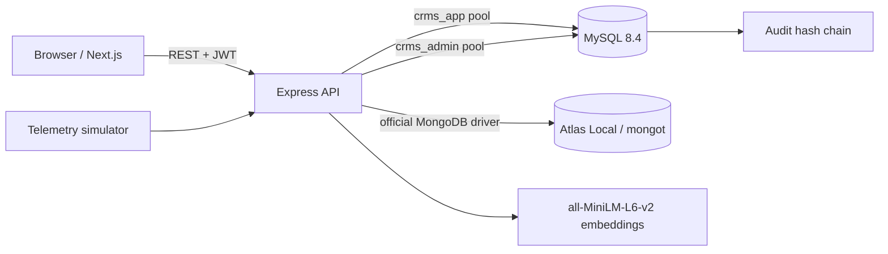

# Architecture

MySQL holds relational entities, job state, scheduler state, usage, rates, and the audit chain. MongoDB holds semi-structured monitoring documents and their vectors. The API scopes project-owned data to the authenticated user; admins can inspect the fleet. MySQL role grants provide a second authorization layer beneath JWT middleware.

The API uses the `crms_app` pool for ordinary user flows and `crms_admin` for administrator-only mutations and audit verification. Database migrations run through the separate `crms_migrator` account. The runtime API never connects as MySQL root.

All service traffic uses container DNS (`mysql`, `mongodb`) and port variables, with Compose-managed named volumes. Browser URLs use localhost ports. No source file depends on Windows drive paths, a specific shell, or a native GPU device.
